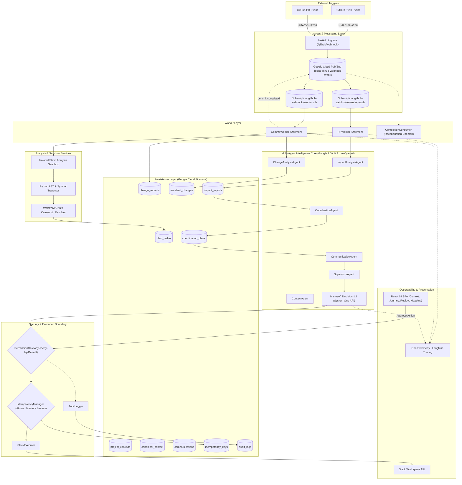
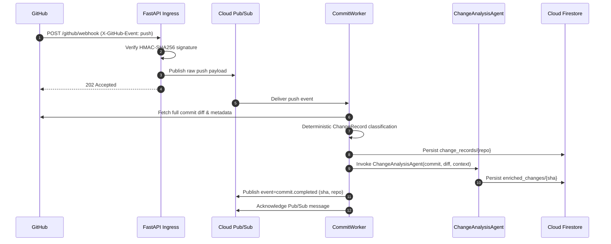
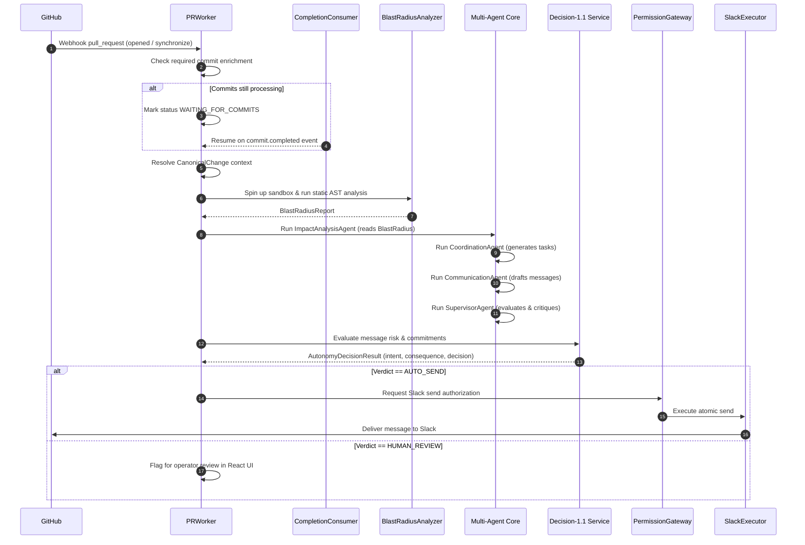
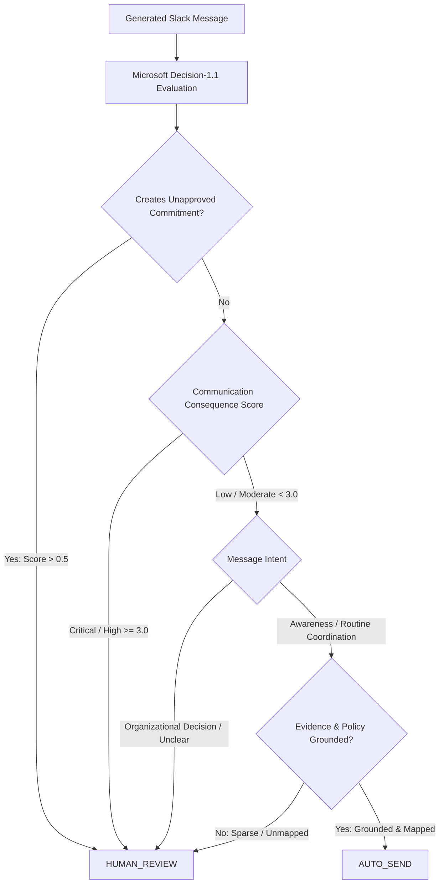

# Dev-Coordination -> A Github - Slack Agentic automation

> **Impact-Aware Engineering Memory & Autonomous Stakeholder Coordination**  
> Continuous change intelligence, static blast-radius analysis, and supervised multi-agent coordination for modern software engineering teams.

> [!NOTE]  
> **Current Scope:** Dev-Coordination is an independently designed prototype currently operating as a **single-user, single-repository workspace**, maintaining engineering context and coordinating changes across one GitHub project.

**Architecture & Capabilities**  
[](#8-multi-agent-architecture)
[](#8-multi-agent-architecture)
[](#7-event-driven-workflows)
[](#9-autonomy--human-in-the-loop-oversight)
[](#10-engineering-reliability--security)

**Core Technologies & Integrations**  
[](https://www.python.org/)
[](https://fastapi.tiangolo.com/)
[](https://github.com/google/adk)
[](https://azure.microsoft.com/)
[](https://cloud.google.com/pubsub)
[](https://cloud.google.com/firestore)
[](https://api.slack.com/)
[](https://react.dev/)
[](https://docs.docker.com/compose/)

**Observability & Governance**  
[](https://opentelemetry.io/)
[](https://langfuse.com/)
[](#10-engineering-reliability--security)

---

## 1. Overview

**Dev-Coordination** is an autonomous engineering coordination platform that transforms raw code churn into actionable, contextual stakeholder intelligence. Rather than acting as a simple PR summarizer or noisy broadcast bot, Dev-Coordination maintains a living, persistent memory of project architecture, tracks how code changes evolve across commits, deterministically computes dependency blast radii, and synthesizes role-tailored notifications.

Equipped with a dual-layer AI decision architecture—combining **Google ADK** multi-agent reasoning with **Microsoft Decision-1.1** System One consequence classification—Dev-Coordination balances autonomous execution with human-in-the-loop oversight. Routine, evidence-backed notifications are delivered autonomously to Slack, while consequential organizational commitments and high-risk changes are routed to engineering leads for explicit approval.

### Primary Pillars
- **Persistent Engineering Memory:** Extracts architectural components, cross-team ownership, and planned tasks from project context and enriches commit events as they land.
- **Deterministic Blast-Radius Static Analysis:** Spins up an isolated, credential-sanitized AST sandbox to inspect import graphs, symbol changes, and CODEOWNERS boundaries without executing untrusted code.
- **Supervised Autonomy via Microsoft Decision-1.1:** Evaluates the *communication risk and commitments* of proposed messages—bypassing false alarms on routine awareness for security PRs while halting unauthorized commitments.
- **Zero-Trust Security & Exactly-Once Delivery:** Enforces a deny-by-default capability matrix across all agent tool calls, protected by atomic distributed idempotency leases and tamper-proof audit trails.

---
## 🖥️ Product Workflow

Dev-Coordination turns engineering activity into persistent context, impact analysis, stakeholder coordination, and targeted communication.

### 1. Build Project Context

Define the project's architecture, objectives, components, ownership, and team structure.  
This context becomes the foundation for subsequent change and impact analysis.

<p align="center">
  
</p>

---

### 2. Map Engineering Stakeholders

Connect project roles and stakeholders with their Slack identities so communication can be routed deterministically to the right people.

<p align="center">
  
</p>

---

### 3. Pull Request Detected

When a new pull request is created, Dev-Coordination detects it and starts the PR analysis and coordination workflow.

<p align="center">
  
</p>

---

### 4. Analyze PR Impact

The system combines enriched commit context with PR information to identify affected components, stakeholders, and the overall impact of the change.

<p align="center">
  
</p>

---

### 5. Determine the Blast Radius

Deterministic repository analysis provides evidence for direct and indirect dependencies, component ownership, and potentially affected teams.

<p align="center">
  
</p>

---

### 6. Generate a Coordination Plan

The agent pipeline converts the impact analysis into structured coordination tasks — identifying who needs awareness, action, or involvement.

<p align="center">
  
</p>

---

### 7. Generate & Review Communication

Context-aware messages are generated for affected stakeholders.  
The supervision and autonomy layer determines whether communication can be sent automatically or requires human review.

<p align="center">
  
</p>

---

### 8. Deliver Targeted Slack Notifications

Approved communication is delivered to the relevant stakeholders with the change, reason for notification, required action, supporting evidence, and confidence.

<p align="center">
  
</p>

---

### 9. Maintain the Engineering Work Journey

Processed commits become part of a persistent engineering memory, creating a traceable history of how the project evolves over time.

<p align="center">
  
</p>

The system provides an integrated React SPA delivering four core operator workflows:

1. **Project Context (`ContextView`):** Ingests architectural requirements, component boundaries, and team mappings, compiling them into a canonical structured project context schema.
2. **Work Journey (`JourneyView`):** A temporal timeline tracking commit evolution, architectural milestones, and component modifications across the codebase.
3. **PR Review & Approval (`ReviewView`):** Comprehensive PR dossier surfacing:
   - Impact classification (Awareness, Action, Approval) and confidence scores.
   - Blast radius dependency graph highlighting direct vs. indirect component modifications.
   - Coordination task breakdowns per team.
   - Pointwise Slack notification drafts with autonomous verdicts (`AUTO_SEND`, `HUMAN_REVIEW`, `BLOCK`, `SKIP`).
   - One-click approval gate for human verification with an async background poller notification bar.
4. **Stakeholder & Slack Mapping (`MappingView`):** Dynamic directory resolving role names, teams, and GitHub handles to verified Slack user IDs (`<@U...>` mentions) and central channels.

---

## 3. The Problem

Modern software development operates at high velocity, but team coordination remains manual, fragmented, and error-prone:

- **Information Fragmentation:** GitHub captures line diffs and commit messages, but loses broader context—why a change was made, which architecture goals it serves, and who outside the PR authors are impacted.
- **Hidden Ripple Effects (Blast Radius):** A modification to a shared database model or utility module can silently break downstream services owned by adjacent teams who never receive review requests.
- **Notification Fatigue vs. Silence:** Broadcast channels spam everyone with noisy PR links, leading engineers to tune them out. Conversely, critical changes frequently slip through without notifying affected stakeholders.
- **Coordination Overhead:** Senior engineers and tech leads spend hours triaging PRs, determining who needs awareness, drafting update messages, and chasing down dependencies manually.
- **Unsupervised AI Risks:** Generative AI bots that draft and send external messages autonomously risk making unauthorized commitments, hallucinating dates, or disclosing internal secrets without policy controls.

---

## 4. Solution Architecture

Dev-Coordination bridges the gap between raw Git events and proactive team coordination:

```mermaid
flowchart LR
    GH[GitHub Push / PR] -->|Webhook| ING[FastAPI Gateway]
    ING -->|Publish| PS[Cloud Pub/Sub]
    PS -->|Push Events| CW[Commit Worker]
    PS -->|PR Events| PW[PR Worker]
    
    subgraph Memory Pipeline
        CW -->|Analyze| CR[ChangeRecord]
        CR -->|Enrich| CAA[ChangeAnalysis Agent]
        CAA -->|Save| EC[(Enriched Changes)]
    end
    
    subgraph Coordination Pipeline
        PW -->|Check Commits| RG{All Commits Enriched?}
        RG -->|No| WAIT[Waiting PR Store]
        RG -->|Yes| CANON[Canonical Context]
        WAIT -.->|Resume via Completion Consumer| CANON
        
        CANON --> BRA[Blast Radius AST Sandbox]
        BRA --> IAA[Impact Analysis Agent]
        IAA --> COA[Coordination Agent]
        COA --> CMA[Communication Agent]
        CMA --> SVA[Supervisor Agent]
    end
    
    subgraph Decision & Governance
        SVA --> MD[Microsoft Decision-1.1]
        MD --> POL{Autonomy Policy}
        POL -->|AUTO_SEND| PG[Permission Gateway]
        POL -->|HUMAN_REVIEW| UI[React Review Dashboard]
        UI -->|Manual Approval| PG
        PG -->|Atomic Lease| IDEM[Idempotency Manager]
        IDEM -->|Post Message| SLK[Slack API Executor]
    end
```



1. **Continuous Memory Building:** Commits are ingested in real-time, categorized deterministically, enriched with behavioral context, and indexed against project tasks.
2. **Deterministic Blast Radius:** Before running LLMs, static analysis inspects imports and symbol references to locate all downstream consumers.
3. **Multi-Agent Reasoning:** Specialized agents analyze impact, schedule coordination tasks, and draft recipient-tailored messages.
4. **Decision-Model Autonomy:** Microsoft Decision-1.1 evaluates communication consequence and unapproved commitments.
5. **Zero-Trust Execution:** Side effects can only be triggered by the `SlackExecutor` after passing through the `PermissionGateway` and securing an atomic idempotency lease.

---

## 5. Key Features

### AI-Powered Commit Understanding
- **Deterministic Classification:** Classifies changes into `feature`, `fix`, `refactor`, `config`, `docs`, and `test` using file patterns and git hunk heuristics before invoking LLMs.
- **Semantic Change Enrichment:** `ChangeAnalysisAgent` extracts intent, before/after behavioral shifts, affected subsystems, and related architectural tasks.

### Persistent Engineering Memory
- **Living Architectural Context:** Maintains structured schemas representing domain models, component graphs, team boundaries, and task dependencies.
- **Single-Writer Canonical Context:** A dedicated resolver (`CanonicalChange`) standardizes PR classification at the workflow head, eliminating semantic drift between pipeline stages.

### Sandboxed Static Blast-Radius Analysis
- **Credential-Sanitized Sandbox:** Clones repository snapshots into an isolated container workspace; strips `.env`, SSH keys, and secret credentials.
- **Zero-Execution AST Parsing:** Traverses Python ASTs to extract imports and top-level function/class symbols; computes dependency depth graphs without executing untrusted code.
- **Authoritative Ownership Mapping:** Intersects changed paths with `CODEOWNERS` and project context to identify responsible teams without hallucination.

### Context-Aware Stakeholder Communication
- **Role-Based Slack Resolution:** Resolves abstract team/stakeholder names to verified Slack IDs (`<@U...>`), stripping model-invented tags and enforcing single-channel routing.
- **Pointwise Message Breakdown:** Drafts concise, bulleted messages outlining *What changed*, *Why it matters to your team*, and *Action required*.

### Supervised Autonomy with Microsoft Decision-1.1
- **Foundry System One Decision API:** Evaluates message risk using typed question schemas (`choice`, `noul`, `score`) rather than loose text generation.
- **Consequence vs. Sensitivity Decoupling:** Understands that a critical security patch PR does not require human gatekeeping if the notification is purely factual awareness.
- **Autonomous Delivery & Human Review:** High-confidence awareness messages are dispatched autonomously (`AUTO_SEND`); new commitments or high-consequence notices require human sign-off (`HUMAN_REVIEW`).

### Production Reliability & Governance
- **Strict Capability Matrix:** Deny-by-default permission checks on every agent tool execution.
- **Atomic Step Idempotency:** SHA-256 fingerprinting with Firestore distributed leases prevents duplicate Slack messages across worker retries and pub/sub redeliveries.
- **Full Traceability & Observability:** Distributed OpenTelemetry tracing exporting OTLP spans to Langfuse alongside structured Firestore audit logging.

---

## 6. System Architecture

The following diagram illustrates the complete end-to-end architecture across infrastructure, compute, intelligence, and storage layers:



---

## 7. Event-Driven Workflows

Dev-Coordination decouples ingestion from heavy processing via asynchronous Cloud Pub/Sub subscriptions.

### Workflow A: Continuous Commit Enrichment Pipeline



### Workflow B: PR Impact, Coordination & Autonomy Pipeline



---

## 8. Multi-Agent Architecture

Dev-Coordination implements Google ADK agents configured with typed Pydantic output schemas, structured tool guards, and explicit access boundaries.

| Agent | Module Path | Primary Output Model | Key Tools & Capability Grants | Default Model |
|---|---|---|---|---|
| **ContextAgent** | `backend/agents/context_agent.py` | `ProjectContextOutput` | Read/Write `project_contexts` | `gemini-3.5-flash` |
| **ChangeAnalysisAgent** | `backend/agents/change_analysis_agent.py` | `EnrichedChangeRecord` | Read `change_records`, Write `enriched_changes` | `gemini-3.5-flash` |
| **ImpactAnalysisAgent** | `backend/agents/impact_analysis_agent.py` | `ImpactReport` | Read `enriched_changes`, Read `blast_radius`, Write `impact_reports` | `gemini-3.5-flash` |
| **CoordinationAgent** | `backend/agents/coordination_agent.py` | `CoordinationPlan` | Read `impact_reports`, Write `coordination_plans` | `gemini-3.5-flash` |
| **CommunicationAgent** | `backend/agents/communication_agent.py` | `CommunicationResult` | Read `coordination_plans`, Write `communications` *(No send tools)* | `gemini-3.5-flash` |
| **SupervisorAgent** | `backend/agents/supervisor_agent.py` | `SupervisionResult` | Read `impact_reports`, Read `coordination_plans`, Critique `communications` | `gemini-3.5-flash` |
| **DecisionService** | `backend/services/decision_service.py` | `AutonomyDecisionResult` | Invokes Microsoft Decision-1.1 via Foundry System One API | `Decision-1.1` |

> [!IMPORTANT]
> **Single-Writer Canonical Principle:** Generative agents are prone to semantic drift (e.g. an initial `fix` drifting into a `refactor` downstream). Dev-Coordination resolves a single `CanonicalChange` model at PR initiation. Downstream agents ingest this canonical definition via payloads, and deterministic schema validators enforce consistency across outputs.

---

## 9. Autonomy & Human-in-the-Loop Oversight

A core architectural challenge in AI engineering coordination is avoiding both **under-automation** (forcing humans to click approve for every routine notification) and **over-automation** (letting models send unauthorized commitments or notify the wrong channels).

### Microsoft Decision-1.1 Integration

Dev-Coordination integrates **Microsoft Decision-1.1** via Microsoft Foundry's documented System One API:
`POST <FOUNDRY_RESOURCE_ENDPOINT>/providers/microsoft/v1/systemone`

Instead of free-form generation, Decision-1.1 accepts a structured state payload and returns typed evaluations across four questions:

```json
{
  "model": "Decision-1.1",
  "state": {
    "action_type": "slack.send",
    "message_text": "...",
    "message_context": { "impact_type": "awareness", "priority": "normal" },
    "supervisor_assessment": { "creates_new_commitment": false, "evidence_quality": "grounded" },
    "trusted_policy_context": { "recipient_authorized": true, "channel_authorized": true }
  },
  "questions": {
    "message_intent": { "type": "choice", "criteria": { "awareness": "...", "new_commitment": "..." } },
    "creates_unapproved_commitment": { "type": "noul" },
    "communication_consequence": { "type": "score" },
    "autonomy_decision": { "type": "choice", "criteria": { "AUTO_SEND": "...", "HUMAN_REVIEW": "...", "BLOCK": "..." } }
  }
}
```

### Consequence Decoupling
Decision-1.1 evaluates the **risk of sending the communication**, not merely the sensitivity of the underlying code change:
- **Security PR Example:** A pull request modifying `auth_service.py` is high-risk in terms of code changes, but a grounded Slack message informing the frontend team that tokens now expire in 15 minutes is low communication consequence $\rightarrow$ **`AUTO_SEND`**.
- **Commitment Example:** A routine documentation PR where the message accidentally states *"The backend team will complete migration by Friday"* introduces an unauthorized organizational commitment $\rightarrow$ **`HUMAN_REVIEW`**.



### Deterministic Restrictiveness Hierarchy
The autonomy policy evaluates decisions using a deterministic strictness order:
$$\text{BLOCK} \succ \text{HUMAN\_REVIEW} \succ \text{SKIP} \succ \text{AUTO\_SEND}$$

If the decision service is unreachable, encounters a timeout, or returns invalid syntax, the policy fails closed to **`HUMAN_REVIEW`**.

---

## 10. Engineering Reliability & Security

### Deny-by-Default Permission Gateway
Every tool call executed by an agent is intercepted by a callback guard that queries `PermissionGateway.authorize()` against 7 strict checks:
1. `check_identity_known`: Agent identity must exist in the registered enumeration.
2. `check_capability`: Requested `(Action, Resource)` tuple must be explicitly granted in `PERMISSION_MATRIX`.
3. `check_project_scope`: Request cannot access data outside the bound `project_id`.
4. `check_external_side_effect`: Side effects (e.g., Slack send) require human approval unless explicitly auto-authorized.
5. `check_recipient_allowed`: Slack recipient must be mapped in project context.
6. `check_already_delivered`: Message ID must not exist in delivered state.
7. `check_sandbox_scope`: Filesystem operations must be contained within sandbox workspace and cannot match secret globs (`.env*`, `*.pem`, `*.key`, `id_rsa*`, `.git/*`).

### Step-Level Idempotency
All pipeline steps are wrapped by `IdempotencyManager`. Leases are claimed atomically in Firestore:
```python
key = sha256(project_id, workflow_id, step_name, canonical_input_fingerprint, version)
```
- **Active Leases:** Protected by a 15-minute lease timeout (`DEFAULT_LEASE_SECONDS = 900`).
- **Crash Recovery:** If a worker crashes mid-execution, subsequent retries reclaim expired leases while preventing double-execution of finished steps.
- **Deduplication:** Repeated webhook deliveries for the same commit or PR head SHA return stored results instantly.

---

## 11. Technology Stack

| Domain | Technology / Library | Purpose |
|---|---|---|
| **Runtime & Core** | Python 3.12, Node.js 20+ | Backend runtime and frontend hosting |
| **API Framework** | FastAPI, Uvicorn, Pydantic v2 | High-performance asynchronous REST API & schema validation |
| **Agent Framework** | Google ADK 2.5.0, Google GenAI | Agent creation, tool-use loops, and session management |
| **Language Models** | Gemini 2.5 Flash, Azure OpenAI (GPT-5-mini) | Semantic code understanding, impact extraction, drafting |
| **Decision Engine** | Microsoft Decision-1.1 (Foundry System One) | Typed autonomy evaluation, commitment & consequence scoring |
| **Cloud Infrastructure** | Google Cloud Pub/Sub, Cloud Firestore | Asynchronous event streaming and NoSQL state persistence |
| **Static Analysis** | Python AST, SymTable, Tarfile API | Sandboxed dependency traversal and symbol change extraction |
| **Communication** | Slack SDK (`WebClient`, Block Kit) | Role-resolved Slack notification dispatch |
| **Observability** | OpenTelemetry SDK, Langfuse | Distributed span tracing, latency monitoring, prompt logging |
| **Frontend UI** | React 18, Vite, Lucide React | Single-page operator dashboard for context, review, and mapping |
| **Containerization** | Docker, Docker Compose | Multi-stage container builds and orchestrated service topology |

---

## 12. Measured Performance Benchmarks

The following latency metrics were captured during end-to-end integration test runs executing full pipeline cycles on live PR events:

### End-to-End Latency

| Lifecycle Event | Measured Duration | Description |
|---|---|---|
| **Commit Ingestion & Enrichment** | **~60.0s** | Push webhook $\rightarrow$ Diff parsing $\rightarrow$ ChangeRecord $\rightarrow$ ChangeAnalysisAgent $\rightarrow$ Firestore |
| **PR-to-Slack End-to-End Delivery** | **184.0s** *(3m 04s)* | PR webhook $\rightarrow$ Static Analysis $\rightarrow$ Multi-Agent Pipeline $\rightarrow$ Decision-1.1 $\rightarrow$ Slack |

### PR Pipeline Stage Breakdown

```
PR Stage Timing Distribution (Total: ~184s)
┌──────────────────────────────────────┬─────────────┬───────────────────────────────┐
│ Stage                                │ Duration    │ Percentage of Runtime         │
├──────────────────────────────────────┼─────────────┼───────────────────────────────┤
│ Prefetch Cache & Blast Radius AST    │   6.87s     │ ██▍ (3.7%)                    │
│ Impact Analysis Agent                │  58.37s     │ ███████████████████▍ (31.7%)  │
│ Coordination Agent                   │  31.37s     │ ██████████▎ (17.0%)           │
│ Supervisor Agent                     │  30.31s     │ █████████▉ (16.5%)            │
│ Communication Agent                  │  27.42s     │ █████████ (14.9%)             │
│ Decision-1.1 Autonomy & Gateway      │  ~1.20s     │ ▍ (0.6%)                      │
│ Overhead (Pub/Sub, Firestore, Slack) │ ~28.46s     │ █████████▎ (15.5%)            │
└──────────────────────────────────────┴─────────────┴───────────────────────────────┘
```

> [!NOTE]
> *Benchmarks represent measured execution times under live API conditions with realistic git diffs (~5-15 modified files). Timing varies with repository graph complexity and external LLM provider response latency.*

---

## 13. Getting Started & Developer Setup

### Prerequisites
- **Docker & Docker Compose** (recommended) or **Python 3.12+** and **Node.js 20+**
- A **Google Cloud Project** with Cloud Firestore and Cloud Pub/Sub enabled
- A **GitHub Personal Access Token** with repository read permissions
- A **Slack Bot Token** (`xoxb-...`) with `chat:write` scopes (optional; mocks available)
- A **Google Gemini API Key** or **Azure OpenAI / Microsoft Foundry** endpoint

---

### Running with Docker Compose (Recommended)

1. **Clone the repository:**
   ```bash
   git clone https://github.com/your-org/dev-coordination.git
   cd dev-coordination
   ```

2. **Configure environment files:**
   Create `backend/.env` and `frontend/.env` using the configuration reference below.

3. **Build and start the complete cluster:**
   ```powershell
   docker compose build
   docker compose up -d
   ```

4. **Verify container health:**
   ```powershell
   docker compose ps
   ```

   The services will be available at:
   - **FastAPI API & Health:** [http://localhost:8000/health](http://localhost:8000/health)
   - **FastAPI Swagger Docs:** [http://localhost:8000/docs](http://localhost:8000/docs)
   - **React Dashboard:** [http://localhost:8501](http://localhost:8501)

5. **Exposing Webhooks via ngrok Tunnel (Optional):**
   To test live GitHub webhooks locally, launch with the `tunnel` profile:
   ```powershell
   docker compose --profile tunnel up -d --build
   ```
   Open the ngrok inspector at [http://localhost:4040](http://localhost:4040) to find your public URL, and set your GitHub Webhook URL to:
   `https://<ngrok-id>.ngrok-free.app/github/webhook`

---

### Running Locally (Bare Metal)

If developing without Docker:

```powershell
# 1. Setup Backend Virtualenv
cd backend
python -m venv venv
.\venv\Scripts\Activate.ps1
pip install -r requirements.txt

# Terminal 1: Launch FastAPI Gateway
python -m uvicorn github_infrastructure.main:app --host 0.0.0.0 --port 8000 --reload

# Terminal 2: Launch Push Commit Consumer
python -c "from github_infrastructure.commit_worker import CommitWorker; CommitWorker().start()"

# Terminal 3: Launch PR Consumer
python -c "from workers.pr_worker import PRWorker; PRWorker().start()"

# Terminal 4: Launch Completion Consumer (Reconciliation)
python -c "from workers.completion_consumer import CompletionConsumer; CompletionConsumer().start()"

# Terminal 5: Launch React Frontend
cd ../frontend
npm install
npm run dev
```

---

### Environment Configuration Reference

All sensitive credentials reside in `backend/.env` (gitignored).

| Variable | Required | Default | Description |
|---|---|---|---|
| `GOOGLE_CLOUD_PROJECT` | Yes | — | GCP Project ID for Cloud Firestore and Pub/Sub |
| `GOOGLE_APPLICATION_CREDENTIALS` | Yes | — | Path to GCP Service Account JSON key |
| `FIRESTORE_DATABASE` | No | `(default)` | Firestore database instance name |
| `GITHUB_WEBHOOK_SECRET` | Yes | — | Secret string used to verify GitHub HMAC signatures |
| `GITHUB_TOKEN` | Yes | — | GitHub PAT for diff extraction and tarball fetching |
| `GOOGLE_API_KEY` | Optional | — | API key for Google Gemini / Google ADK models |
| `PROVIDER` | No | `google` | LLM backend: `google` or `azure` |
| `AZURE_API_KEY` | Optional | — | Azure OpenAI API key (if `PROVIDER=azure`) |
| `AZURE_API_BASE` | Optional | — | Azure OpenAI endpoint base URL |
| `AZURE_DEPLOYMENT` | Optional | — | Azure OpenAI model deployment name |
| `DECISION_MODEL_ENABLED` | No | `false` | Enable Microsoft Decision-1.1 System One integration |
| `DECISION_FOUNDRY_ENDPOINT` | Optional | — | Microsoft Foundry endpoint URL |
| `DECISION_MODEL_DEPLOYMENT` | Optional | `Decision-1.1` | Deployment name for Decision model |
| `DECISION_API_KEY` | Optional | — | Microsoft Foundry API key |
| `DECISION_SHADOW_MODE` | No | `false` | Record Decision-1.1 verdicts without altering routing |
| `AUTONOMY_ENABLED` | No | `false` | Master toggle for autonomous Slack delivery |
| `SLACK_BOT_TOKEN` | Optional | — | Slack Bot Token (`xoxb-...`); mocks used if absent |
| `SLACK_STRICT` | No | `false` | If true, raises exceptions on delivery failure vs mock |
| `TELEMETRY_ENABLED` | No | `true` | Enable OpenTelemetry tracing export |
| `LANGFUSE_PUBLIC_KEY` | Optional | — | Langfuse project public key |
| `LANGFUSE_SECRET_KEY` | Optional | — | Langfuse project secret key |
| `LANGFUSE_HOST` | Optional | `https://cloud.langfuse.com` | Langfuse instance host URL |

---

## 14. Testing Suite

Dev-Coordination maintains a separation between offline hermetic unit suites and live service integration tests.

### Offline Hermetic Unit Tests
These tests validate security gates, static analysis, policy matrices, and decision parsing without network access or cloud dependencies:

```powershell
cd backend
$env:PYTHONPATH=".;venv\Lib\site-packages"
pytest tests/test_permissions_gateway.py `
       tests/test_idempotency.py `
       tests/test_decision_service.py `
       tests/test_autonomy.py `
       tests/test_pr_review_api.py `
       tests/test_blast_radius_service.py `
       tests/test_sandbox_policy.py `
       tests/test_symbol_dependency.py `
       tests/test_ownership_resolver.py `
       tests/test_slack_mentions.py
```

### Live End-to-End Tests
Live test scripts exercise real cloud resources and external APIs:
- `tests/test_full_pipeline.py`: Simulates end-to-end PR workflow execution with real LLMs and Firestore.
- `tests/test_push_pipeline.py`: Validates commit ingestion through Pub/Sub and ChangeRecord enrichment.
- `tests/test_slack.py`: Dispatches a live test message to a verified Slack test channel.

---

## 15. Repository Structure

```
dev-coordination/
├── backend/
│   ├── agents/                   # Google ADK agent implementations
│   │   ├── change_analysis_agent.py   # Semantic commit diff enrichment
│   │   ├── communication_agent.py     # Role-specific Slack draft generator
│   │   ├── context_agent.py           # Structured project model extractor
│   │   ├── coordination_agent.py      # Team coordination task generator
│   │   ├── impact_analysis_agent.py   # Blast-radius & impact reasoner
│   │   ├── prefetch_cache.py          # Evidence prefetch caching
│   │   └── supervisor_agent.py        # Communication critique and revision
│   ├── api/                      # FastAPI REST endpoints
│   │   └── projects.py                # Context, commits, PR review & approvals
│   ├── autonomy/                 # Autonomy decision engine & policy rules
│   │   ├── config.py                  # Autonomy configuration getters
│   │   ├── models.py                  # Pydantic models for autonomy batches
│   │   ├── policy.py                  # Deterministic decision ordering rules
│   │   └── runner.py                  # Batch evaluation & auto-send runner
│   ├── blast_radius/             # Isolated AST static analysis & graph engine
│   │   ├── blast_radius_service.py    # Sandboxed analysis orchestrator
│   │   ├── dependency_analyzer.py     # Import graph BFS traversal
│   │   ├── diff_analyzer.py           # Modified file & hunk parser
│   │   ├── models.py                  # BlastRadiusReport data models
│   │   ├── ownership_resolver.py      # CODEOWNERS & context matcher
│   │   ├── sandbox.py                 # Credential-sanitized workspace sandbox
│   │   └── symbol_analyzer.py         # Python AST function & class extractor
│   ├── coordination/             # Canonical change models & reconciliation
│   │   ├── canonical.py               # Single-writer canonical classification
│   │   ├── config.py                  # Step names and queue configurations
│   │   ├── gate.py                    # Commit readiness checking logic
│   │   ├── reconciler.py              # Waiting PR recovery logic
│   │   └── stores.py                  # CommitStatus & PRWorkflow stores
│   ├── github_infrastructure/    # Webhook handling, Pub/Sub, ChangeRecords
│   │   ├── change_records.py          # Deterministic git diff classifier
│   │   ├── commit_worker.py           # Push event Pub/Sub subscriber
│   │   ├── extractors.py              # Webhook payload metadata extractors
│   │   ├── main.py                    # FastAPI application initialization
│   │   ├── publisher.py               # Pub/Sub event publishing wrapper
│   │   ├── routes.py                  # GitHub webhook POST endpoint
│   │   └── security.py                # HMAC signature verification
│   ├── project_context/          # Canonical ProjectContext schema definitions
│   │   └── models.py                  # Architecture, stakeholders, tasks
│   ├── security/                 # Zero-trust governance & side-effect execution
│   │   ├── approval.py                # Human approval binding validation
│   │   ├── audit.py                   # Structured audit logger & Firestore sink
│   │   ├── execution.py               # SlackExecutor (the only send component)
│   │   ├── gateway.py                 # PermissionGateway (policy checks)
│   │   ├── guard.py                   # ADK before_tool_callback wrapper
│   │   ├── idempotency.py             # Atomic distributed Firestore leases
│   │   ├── identities.py              # Agent, Action, and Resource enums
│   │   ├── permissions.py             # Deny-by-default capability matrix
│   │   └── policies.py                # Deterministic security policy checks
│   ├── services/                 # External service integrations
│   │   ├── decision_service.py        # Microsoft Decision-1.1 System One client
│   │   ├── slack_mentions.py          # Role-based Slack user ID resolver
│   │   └── slack_service.py           # Slack API WebClient wrapper & throttler
│   ├── telemetry/                # OpenTelemetry & Langfuse observability
│   │   ├── config.py                  # Telemetry configuration & endpoints
│   │   ├── spans.py                   # Fail-open span wrappers & link helpers
│   │   └── tracer.py                  # TracerProvider initialization
│   ├── tests/                    # Unit, regression, and live test suites
│   ├── workers/                  # Dedicated Pub/Sub background workers
│   │   ├── completion_consumer.py     # Commit completion reconciliation worker
│   │   └── pr_worker.py               # PR event consumer & workflow runner
│   ├── workflows/                # Long-running multi-step workflow logic
│   │   └── pr_workflow.py             # Full PR coordination workflow engine
│   ├── Dockerfile                # Multi-stage container build definition
│   └── requirements.txt          # Python library dependencies
├── frontend/                     # React operator dashboard
│   ├── src/
│   │   ├── App.jsx                    # SPA views (Context, Journey, Review, Mapping)
│   │   ├── api.js                     # REST API client & background polling
│   │   ├── main.jsx                   # React application mount
│   │   └── styles.css                 # Dark theme design system & layout
│   ├── server.mjs                # Production Node.js server with backend proxy
│   ├── package.json              # Vite & React dependencies
│   └── vite.config.js            # Vite build configuration
├── compose.yaml                  # Multi-service Docker Compose topology
└── README.md                     # Project documentation
```

---

## 16. Current Limitations & Roadmap

> [!NOTE]
> **Current Scope:** Dev-Coordination is an independently designed prototype currently operating as a **single-user, single-repository workspace**, maintaining engineering context and coordinating changes across one GitHub project.

### Current Limitations
- **Current Scope:** Dev-Coordination is an independently designed prototype currently operating as a **single-user, single-repository workspace**, maintaining engineering context and coordinating changes across one GitHub project.
- **Language Support for ASTs:** The sandboxed blast-radius analyzer currently parses Python import graphs and symbols natively. TypeScript/Go/Java analysis relies on component path matching.
- **Approver Authentication:** The `/api/projects/{id}/prs/{n}/approve` endpoint validates approval consistency and records an audit log, but does not yet enforce OAuth/SSO identity tokens.
- **Git History in Sandboxes:** The sandbox provisions a lightweight tarball snapshot at the PR head SHA without full commit history, limiting contributor-frequency heuristics.
- **Single Channel per Project:** Slack messages are currently mapped to a designated project notification channel; per-team channel routing is in progress.

### Future Roadmap
- [ ] **Polyglot Tree-sitter Blast Radius:** Expand native AST dependency analysis to TypeScript, Go, Rust, and Java using Tree-sitter.
- [ ] **Interactive Slack App Buttons:** Allow tech leads to approve or revise drafted notifications directly inside Slack using interactive Block Kit buttons.
- [ ] **Post-Merge Verification Loops:** Monitor deployment webhooks and error-tracking systems (Sentry/Datadog) to verify that coordinated migrations succeeded.
- [ ] **Jira & Linear Sync:** Bidirectional synchronization linking PR coordination tasks directly to sprint tickets and project roadmaps.

---

## 17. Acknowledgments

Dev-Coordination was built by combining agentic reasoning with deterministic systems engineering:
- **Google DeepMind & Google Cloud:** For the Google Agent Development Kit (ADK) and Gemini models.
- **Microsoft Foundry Team:** For the Microsoft Decision-1.1 System One Decision API and model catalog.
- **Langfuse:** For open-source LLM observability and distributed tracing support.
- **FastAPI & Pydantic:** For modern, robust asynchronous Python infrastructure.

---

*Authored for modern engineering teams striving for clarity, velocity, and coordinated change.*
